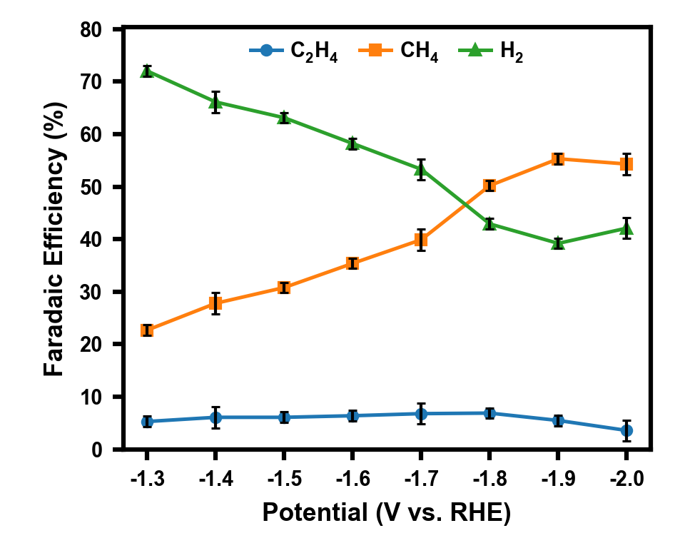
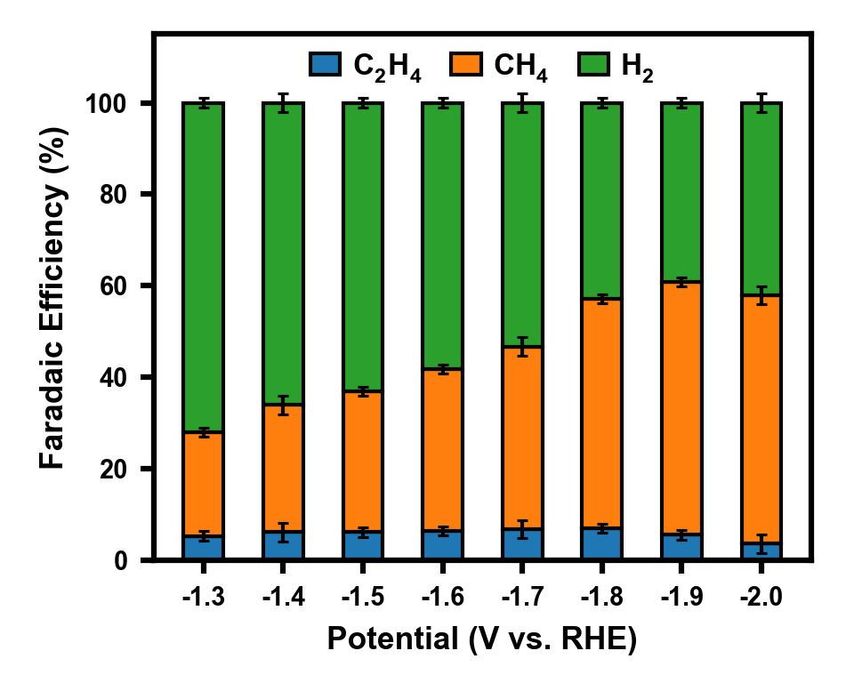
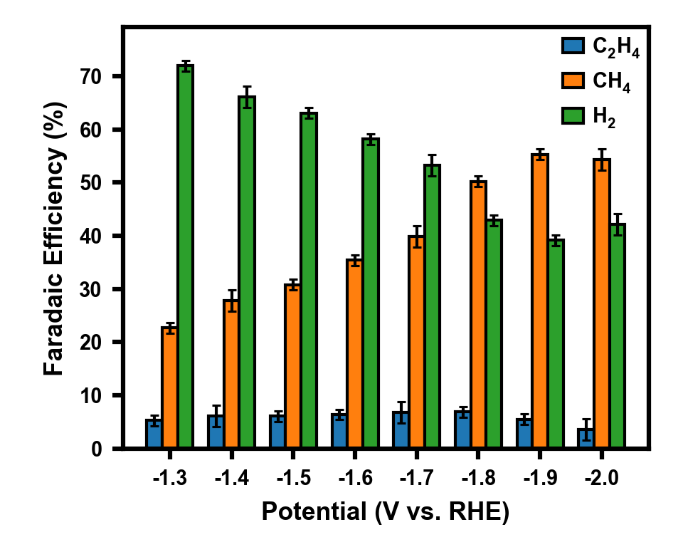
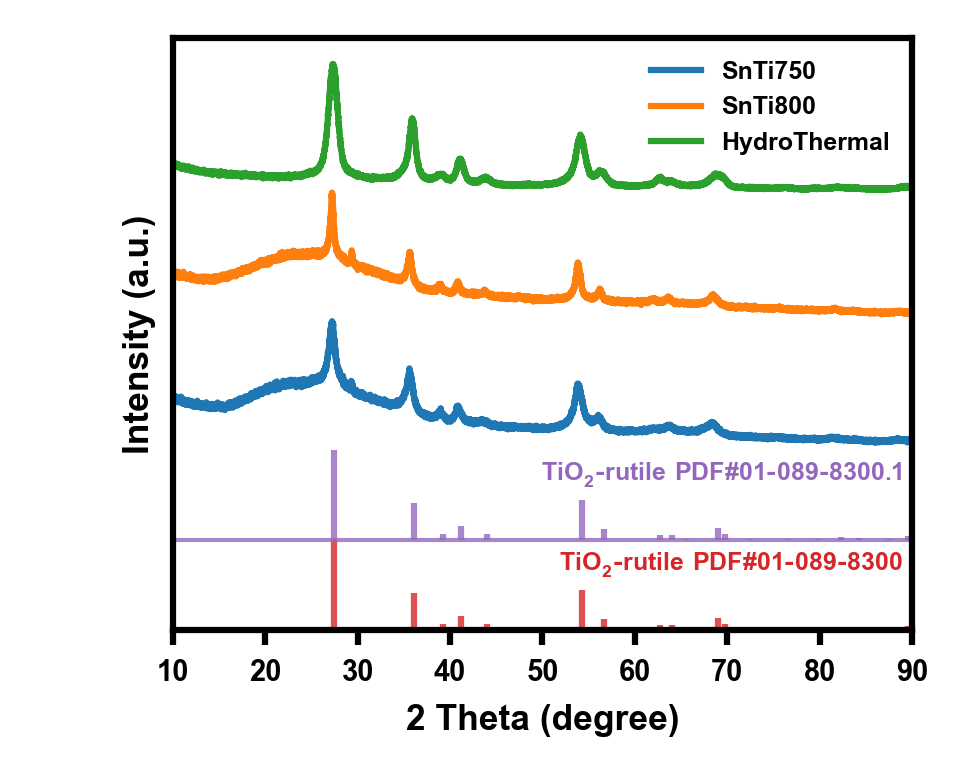

# auto-sci-graphics

[中文](README.md) | **English**

Publication-ready electrocatalysis figures in a consistent style, one Python command each. No Origin, no tweaking every figure by hand.

Three kinds of figures are supported:

| FE line chart | FE stacked bar chart | FE grouped bar chart | XRD pattern |
|:---:|:---:|:---:|:---:|
|  |  |  |  |
| `FEline.py` | `FEcolumn.py` | `FEcolumn.py -group` | `XRD.py` |

(FE = Faradaic efficiency.)

Every figure shares the same style:

- 3.2 × 2.56 in, the width of a single journal column
- 300 DPI PNG
- Bold Arial
- Automatic subscripts in chemical formulas (H₂, C₂H₄, TiO₂)
- A colorblind-friendly palette, one flag away

## Installation

Requires Python 3.9 or later.

```bash
git clone https://github.com/JackieRooot/auto-sci-graphics
cd auto-sci-graphics
pip install -r requirements.txt
```

## Quick start

Sample data ships with the repository, so you can try it right away:

```bash
python FE_figure/FEline.py -e          # line chart with error bars
python FE_figure/FEcolumn.py -e        # stacked bar chart with error bars
python XRD_figure/XRD.py               # XRD pattern
```

Without `-o`, the figure is saved next to the data file.

To plot your own data, prepare a file in the same format as the sample Excel files and pass it with `-i`:

```bash
python FE_figure/FEline.py -i D:/data/my_fe.xlsx -e -o D:/figures/
python XRD_figure/XRD.py   -i D:/data/my_xrd.xlsx -o D:/figures/ --xmin 20 --xmax 80
```

## Preparing your data

The easiest way: copy a sample Excel file from the repository and fill in your own numbers.

### Faradaic efficiency

Sample file: [`FE_figure/FEDataSourceForColumns.xlsx`](FE_figure/FEDataSourceForColumns.xlsx)

Sheet `FE`:

| Potential | H2 | CO | CH4 | C2H4 | … |
|---|---|---|---|---|---|
| -1.3 | 0.720 | | 0.227 | 0.053 | |
| -1.4 | 0.661 | | 0.278 | 0.061 | |

- The first column is the x-axis (usually the potential); each remaining column is one product.
- **Enter Faradaic efficiencies as fractions**, e.g. 0.72 for 72%.
- Use chemical formulas as column names, such as `H2` or `C2H4`; the legend renders them with subscripts. Supported products are listed in [`FE_substance_config.py`](FE_figure/FE_substance_config.py). Edit that file to add a product or change a display name (for example, to show `HCOOH` as `Formate`).
- Leave columns without data empty; they are skipped automatically.

Sheet `SD` (only needed for error bars): same layout as `FE`, filled with standard deviations.

### XRD

Sample file: [`XRD_figure/XRDDatasource.xlsx`](XRD_figure/XRDDatasource.xlsx)

Sheets `Sample` (your samples) and `Standard` (reference PDF cards) share the same layout: columns come in pairs, angle first, then intensity.

| 2 Theta (°) | SnTi750 | 2 Theta (°) | SnTi800 | … |
|---|---|---|---|---|
| 5.00 | 2721 | 5.00 | 2779 | |

- **The header of each angle column must contain `2 Theta`**, otherwise that pair of columns is ignored.
- The header of each intensity column becomes the sample or card name in the figure. Use `_` for subscripts in card names: `TiO_2-rutile PDF#01-089-8300` is shown as TiO₂-rutile PDF#01-089-8300.
- Enter raw counts; intensities are normalized automatically.
- Every sample and card name must be unique. A duplicated name shows up in the figure with an extra `.1` suffix.

## Command-line options

| Option | Scripts | Effect |
|---|---|---|
| `-i, --input` | all | Input Excel file. Defaults to the sample file next to the script |
| `-o, --output` | all | Output path. A trailing `/` means a directory (created if missing); otherwise it is a file name |
| `-cb` | all | Colorblind-friendly palette (Wong) |
| `-e` | both FE scripts | Draw error bars; requires the `SD` sheet |
| `-group` | `FEcolumn.py` | Grouped bars instead of the default stacked bars |
| `--xmin`, `--xmax` | `XRD.py` | x-axis range, default 10–90 |
| `--spacing` | `XRD.py` | Spacing between adjacent sample curves, default 1.0. Smaller (e.g. 0.6) packs curves closer with taller peaks; larger (e.g. 1.4) spreads them out |

If the output file already exists, a `_1`, `_2`, … suffix is added, so earlier figures are never overwritten.

## Using with a coding agent

These scripts work well when driven by a coding agent: Claude Code CLI, Codex, Qoder, or any other tool that can read code and run commands.

The repository includes [`CLAUDE.md`](CLAUDE.md), which describes the data formats, the plotting workflow and common pitfalls. Claude Code reads it automatically when it opens the repository; for agents that don't, ask the agent to read that file at the start of the conversation. (The file is written in Chinese; agents handle that fine.) After that, you can hand over your raw data directly, for example:

> My GC quantification results are in `D:\data\run3\`. Make an FE stacked bar chart with error bars in this repository's style. Show me the tidied data for confirmation before plotting.

The agent tidies the data into the format above, runs the script and checks the result. You don't need to reformat the data yourself or understand how the style is implemented.

## Customizing the style

- **FE figures**: the palette and marker shapes are `PALETTES` and `MARKERS` at the top of each script; canvas size, font sizes and margins are in `generate_figure()`.
- **XRD figures**: all style parameters live in `FIGURE_CONFIG` at the top of `XRD.py`.

Each script opens with a detailed docstring (in Chinese) listing every style parameter.

## License

[AGPL-3.0](LICENSE)
